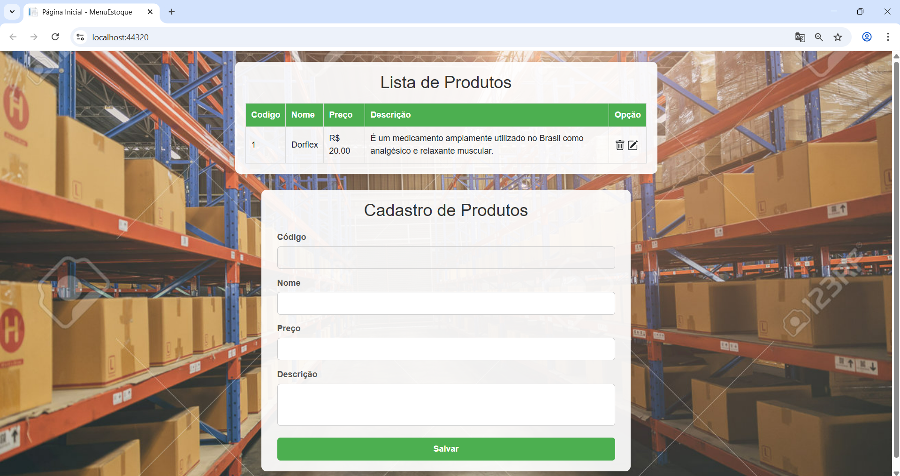
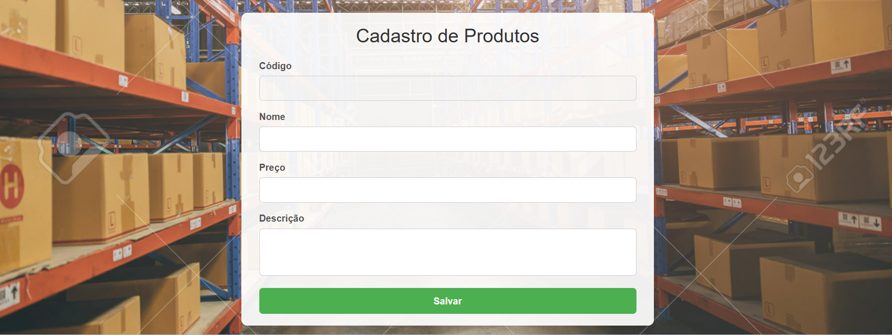
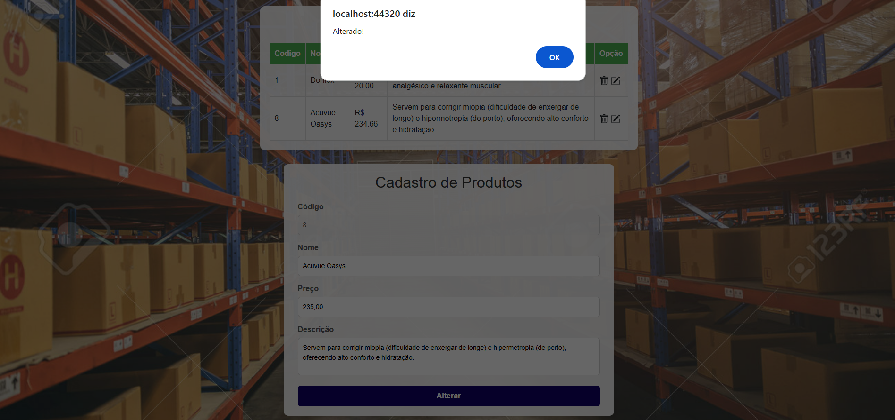
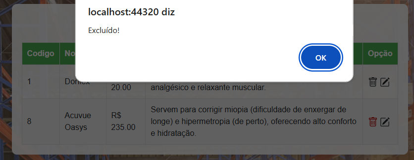

# MenuEstoque

## Descrição

MenuEstoque é uma aplicação web desenvolvida em ASP.NET MVC com Entity Framework Core, voltada para o gerenciamento simples de produtos em estoque.

O projeto tem como objetivo demonstrar conceitos fundamentais de desenvolvimento back-end com .NET, incluindo CRUD, arquitetura em camadas e o uso do padrão Repository.

  

---

## Funcionalidades

### Listagem de produtos

### Cadastro de novos produtos

### Edição de produtos existentes

### Exclusão de produtos

- Atualização dinâmica de dados via AJAX

---

## Arquitetura do Projeto

O projeto segue o padrão MVC (Model-View-Controller), garantindo separação clara de responsabilidades.

### Estrutura de camadas

* Models:
  Contém as entidades do sistema, como ProdutoModel.

* Data:
  Responsável pelo contexto de banco de dados (BancoContext) utilizando Entity Framework Core.

* Repositorio:
  Implementa o padrão Repository para abstração do acesso a dados:

  * IProdutoRepositorio
  * ProdutoRepositorio

* Controllers:
  Contém o HomeController, responsável pelas operações de CRUD e comunicação com o front-end.

* Views:
  Interface do usuário construída com Razor.

---

## Padrão Repository

O padrão Repository foi aplicado com o objetivo de:

* Evitar acoplamento direto entre Controller e Entity Framework
* Centralizar regras de acesso a dados
* Facilitar manutenção e testes

### Métodos implementados

* ListarTodos()
* ObterPorId(int id)
* IncluirProduto(ProdutoModel produto)
* AtualizarProduto(ProdutoModel produto)
* DeletarProduto(int id)

---

## Tecnologias Utilizadas

* ASP.NET MVC
* C#
* Entity Framework Core
* SQL Server
* HTML5
* CSS3
* JavaScript (AJAX)

---

## Interface

A interface foi desenvolvida com foco em simplicidade e usabilidade, utilizando CSS puro para estilização e JavaScript para comunicação assíncrona.

---

## Como Executar o Projeto

1. Clonar o repositório
2. Configurar a string de conexão no arquivo appsettings.json
3. Executar o projeto pelo Visual Studio

---

## Observações

Este projeto não possui autenticação ou controle de acesso, pois o foco está na implementação do CRUD e na organização do código.

Em um cenário real, poderiam ser aplicadas soluções como ASP.NET Identity ou autenticação via JWT.

---

## Autor

Alan Santos

Desenvolvedor .NET

---
